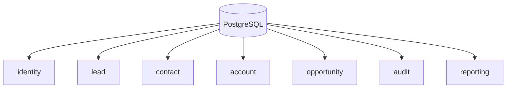

# CRM Platform - Database Design

**Version:** 1.0  
**Status:** Draft  
**Last Updated:** June 2026

---

# Table of Contents

1. Purpose
2. Database Strategy
3. Design Principles
4. Database Architecture
5. Service Schemas
6. Naming Conventions
7. Primary Keys
8. Relationships
9. Indexing Strategy
10. Audit Columns
11. Soft Deletes
12. Migrations
13. Backup & Recovery
14. Future Enhancements

---

# 1. Purpose

This document defines the database architecture, ownership model, naming conventions, and design principles for the CRM Platform.

The database layer is designed around microservice principles where each service owns its data.

---

# 2. Database Strategy

The platform uses a single PostgreSQL instance during development.

Each microservice owns its own schema.

```text
PostgreSQL
│
├── identity
├── lead
├── contact
├── account
├── opportunity
├── audit
└── reporting
```

No service may directly access another service's schema.

---

# 3. Design Principles

- Database per Service (Schema per Service)
- Strong consistency within a service
- No cross-service joins
- UUID primary keys
- Foreign keys only within a schema
- Event-driven synchronization across services
- Explicit indexing strategy
- Auditability

---

# 4. Database Architecture



---

# 5. Service Schemas

## Identity Schema

Stores:

- Users
- Roles
- Permissions
- Refresh Tokens

## Lead Schema

Stores:

- Leads
- Lead Status
- Lead Source
- Lead Assignment

## Contact Schema

Stores:

- Contacts
- Email Addresses
- Phone Numbers

## Account Schema

Stores:

- Organizations
- Companies
- Customer Accounts

## Opportunity Schema

Stores:

- Opportunities
- Pipeline Stages
- Revenue Forecast

## Audit Schema

Stores immutable audit logs.

## Reporting Schema

Stores reporting aggregates and materialized data.

---

# 6. Naming Conventions

## Tables

Use snake_case and plural names.

Examples

```text
users
roles
permissions
leads
contacts
accounts
opportunities
```

## Columns

```text
id
created_at
updated_at
deleted_at
created_by
updated_by
```

---

# 7. Primary Keys

All tables use UUID.

Example

```sql
id UUID PRIMARY KEY
```

Advantages:

- Globally unique
- Safe across distributed systems
- Prevents ID enumeration

---

# 8. Relationships

Relationships exist only within a schema.

```text
Account
   │
   └── Contacts

Lead
   │
   └── Activities
```

Cross-service relationships are maintained through events and external identifiers.

---

# 9. Indexing Strategy

Indexes should be created for:

- Primary Keys
- Foreign Keys
- Frequently searched columns
- Email
- Username
- Status
- Created Date

Example

```sql
CREATE INDEX idx_leads_status
ON lead.leads(status);
```

---

# 10. Audit Columns

Every business table should contain:

```text
created_at
updated_at
created_by
updated_by
deleted_at
```

These support auditing and traceability.

---

# 11. Soft Deletes

Business entities use soft deletes.

```text
deleted_at TIMESTAMP NULL
```

Records are marked deleted instead of being permanently removed.

Audit tables remain immutable and are never soft deleted.

---

# 12. Migrations

Schema changes must be managed through version-controlled migrations.

Guidelines:

- One migration per change
- Never modify applied migrations
- Rollback scripts where practical
- Migrations executed automatically during deployment

---

# 13. Backup & Recovery

Development:

- Local PostgreSQL backups

Production:

- Automated daily backups
- Point-in-time recovery
- Encrypted backup storage
- Periodic restore testing

---

# 14. Future Enhancements

- Separate database per service
- Read replicas
- Partitioning for audit data
- Database sharding
- Data archival strategy
- Multi-region replication
- Encryption at rest
