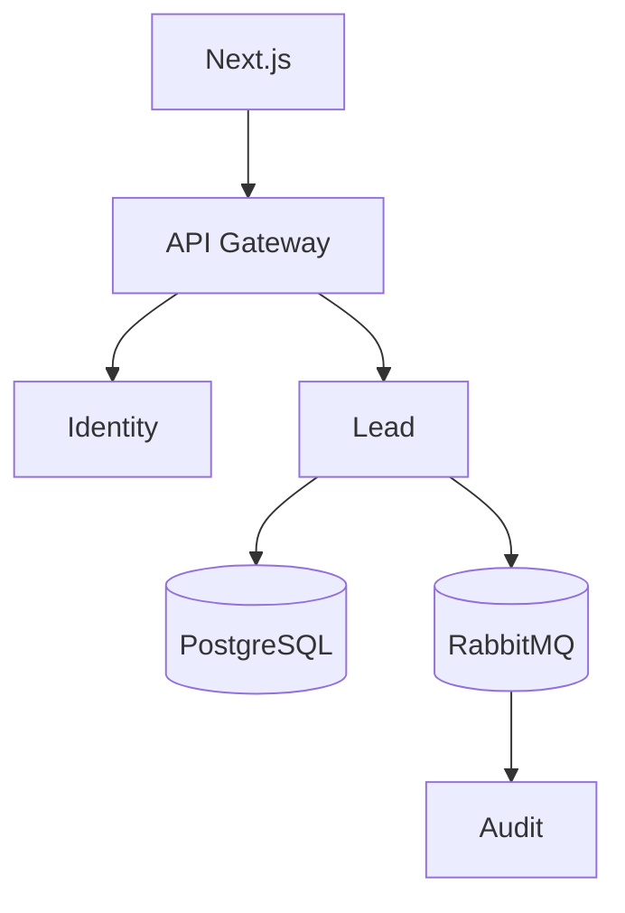

# CRM Platform - System Architecture

**Version:** 1.0

## Purpose
This document defines the architecture of the CRM Platform.

## High-Level Architecture
```text
Frontend (Next.js)
    |
API Gateway
    |
Platform Services
CRM Services
Infrastructure
```



## Platform Services
- Identity
- Notification
- File
- Audit
- Reporting

## CRM Services
- Lead
- Contact
- Account
- Opportunity

## Infrastructure
- PostgreSQL
- Redis
- RabbitMQ
- Amazon S3
- Prometheus
- Grafana
- Loki
- Jaeger

## Communication
REST for synchronous requests and RabbitMQ for asynchronous events.
